<a href="https://github.com/anthod0">
  <picture>
    <source media="(prefers-color-scheme: dark)" srcset="./assets/hero-dark.svg">
    
  </picture>
</a>

<a href="https://x.com/anthod0"><picture><source media="(prefers-color-scheme: dark)" srcset="./assets/badges/x-dark.svg"></picture></a>
<a href="https://reela.com/"><picture><source media="(prefers-color-scheme: dark)" srcset="./assets/badges/reela-dark.svg"></picture></a>
<a href="https://pontia.dev/"><picture><source media="(prefers-color-scheme: dark)" srcset="./assets/badges/pontia-dark.svg"></picture></a>
<a href="https://github.com/anthod0/skills"><picture><source media="(prefers-color-scheme: dark)" srcset="./assets/badges/skills-dark.svg"></picture></a>
<a href="https://github.com/anthod0/dotfiles"><picture><source media="(prefers-color-scheme: dark)" srcset="./assets/badges/dotfiles-dark.svg"></picture></a>

## What I build

- [Reela](https://reela.com/) — AI video creation platform.
- [Pontia](https://pontia.dev/) — Remote control for coding agents.

## Projects

### [pontia](https://github.com/anthod0/pontia)

[pontia.dev](https://pontia.dev/) · Rust, TypeScript · Apache-2.0

- Manage agent sessions from a web dashboard. Agents stay on the user's device.
- End-to-end encrypted remote access between the browser and the device.
- Real-time two-way session sync across the agent TUI and the web dashboard.
- Multi-step workflows with replanning.

### [pi-lab](https://github.com/anthod0/pi-lab)

TypeScript · MIT

- A set of lightweight, composable pi extensions.
- 12 packages on npm.

### [better-skills](https://github.com/anthod0/better-skills)

TypeScript, Bun · MIT

- pnpm-inspired design: content-addressable store with deduplication, profiles, and versioning.
- Interactive TUI for managing skills, profiles, and clients.

## Merged pull requests

- remotion-dev/remotion — [4 merged PRs](https://github.com/remotion-dev/remotion/pulls?q=is%3Apr+author%3Aanthod0+is%3Amerged):
  - [#11331](https://github.com/remotion-dev/remotion/pull/11331) `@remotion/renderer`: fixed BT.709 color conversion for JPEG frames.
  - [#11071](https://github.com/remotion-dev/remotion/pull/11071) `@remotion/serverless`: fixed warm Lambda exits after flaky renderer errors.
  - [#10383](https://github.com/remotion-dev/remotion/pull/10383) `@remotion/lambda`: added AWS China region support.
  - [#10320](https://github.com/remotion-dev/remotion/pull/10320) fixed the monorepo pre-commit hook on Linux.
- nicobailon/pi-mcp-adapter — [#231](https://github.com/nicobailon/pi-mcp-adapter/pull/231): fixed a Pi crash when a long-running tmux server kept a revoked Linux session keyring; OAuth stays fail-closed.
- better-auth/better-auth — [#5182](https://github.com/better-auth/better-auth/pull/5182): fixed falsy default values being skipped.

## Also

- [singBoost](https://github.com/anthod0/singBoost) — minimal Windows tray launcher for the sing-box core.
- [product-intel-workflow](https://github.com/anthod0/product-intel-workflow) — Grok Build workflow that turns a product repo into a product-intelligence pack with a dashboard.
